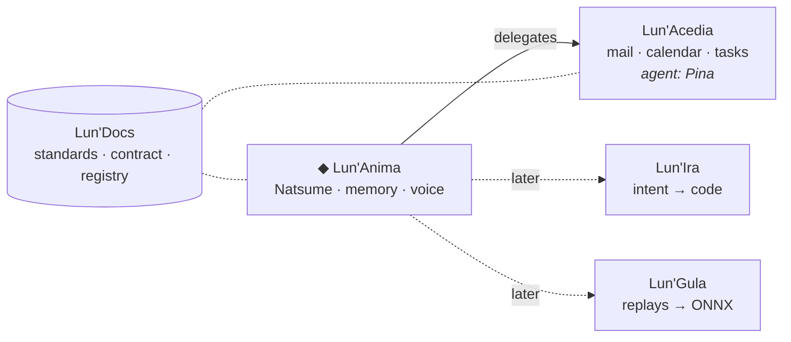

<div align="center">

# Lun' Ecosystem

**A set of standalone tools orbiting one entity: Natsume Tsurugi, a personal assistant with a character.**

[](https://crolix-website.vercel.app)
[](https://github.com/Lun-Ecosystem/lun-docs)

```
  ┌─────────────────────────────────────────────────────────────┐
  │  "Born from scattered memories.                             │
  │   Awakened to unite them."                                  │
  │                                         — Natsume Tsurugi   │
  └─────────────────────────────────────────────────────────────┘
```

</div>

---

## ◈ the idea

Each tool does one job well and works on its own. Natsume, the core, links them: she understands what
you ask, hands the work to the right tool, keeps the memory and reports back. Turn her off and every
tool keeps working.



## ◈ projects

| Project | Role | What it is | Status |
|---|---|---|---|
| **Lun'Anima** · _private_ | core | Natsume: persona, memory, conversation, desktop and mobile apps |  |
| [`lun-acedia`](https://github.com/Lun-Ecosystem/lun-acedia) | satellite | The day's server: mail, calendar and tasks, sorted at the source, with its own assistant |  |
| [`LunIra`](https://github.com/CrOliX-AltF4/LunIra) | satellite | Multi-agent CLI that turns an intent into shippable code |  |
| [`LunGula`](https://github.com/CrOliX-AltF4/LunGula) | satellite | Imitation learning: human replays in, ONNX model out |  |
| [`lun-docs`](https://github.com/Lun-Ecosystem/lun-docs) | reference | Shared standards, the satellite contract, the project registry and a Claude Code plugin |  |

The registry in [`lun-docs`](https://github.com/Lun-Ecosystem/lun-docs) is the source of truth for this list.

## ◈ how it holds together

- **Standalone first.** Every satellite works on its own, with its own screen.
- **The satellite owns its business.** Its rules, its actions and its guardrails live in one place. The
  core never re-implements them: it links the tool to the brain.
- **One agent per satellite, delegated by the core.** Each satellite can carry an assistant bound to its
  mission. The core routes the request, delegates, keeps the memory and gives the answer back.
- **Human in control.** Nothing destructive or outgoing happens without a click: deletions are always
  confirmed, mail is drafted, never sent by an agent. Every AI can be paused or switched off.
- **Private by default.** Self-hosted, nothing exposed to the internet, no secret in the public repos.

---

<div align="center">

Built by [CrOliX-AltF4](https://github.com/CrOliX-AltF4). Lun'Anima and its visual assets are proprietary; the public repositories carry their own licence.

</div>
