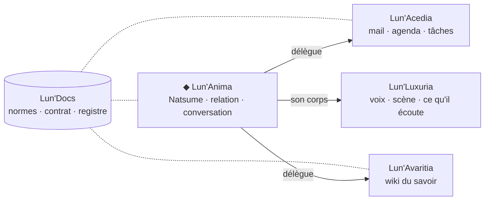

<div align="center">

# Lun' Ecosystem

**Des outils autonomes qui gravitent autour d'une entité : Natsume Tsurugi, une assistante personnelle avec un vrai
caractère.**

[](https://github.com/Lun-Ecosystem/lun-docs)

```
  ┌─────────────────────────────────────────────────────────────┐
  │  "Born from scattered memories.                             │
  │   Awakened to unite them."                                  │
  │                                         — Natsume Tsurugi   │
  └─────────────────────────────────────────────────────────────┘
```

</div>

---

## ◈ l'idée

Chaque outil fait bien une seule chose et fonctionne seul. Natsume, le core, les relie : elle comprend ce que tu
demandes, confie le travail au bon outil, se souvient de votre histoire commune et te rend compte. Éteins-la, et chaque
outil continue de tourner.



## ◈ les projets

| Projet | Rôle | Ce que c'est | État |
|---|---|---|---|
| **Lun'Anima** · _privé_ | core | Natsume : son identité, la mémoire de la relation, la conversation, et son app (une PWA, au bureau et au téléphone) |  |
| [`lun-acedia`](https://github.com/Lun-Ecosystem/lun-acedia) | satellite | Le serveur de la journée : mail, agenda et tâches, triés à la source, avec son propre assistant |  |
| [`lun-avaritia`](https://github.com/Lun-Ecosystem/lun-avaritia) | satellite | La base de savoir de l'écosystème : des fiches reliées et normalisées, aux faits sourcés, avec l'import et l'export Obsidian |  |
| [`lun-luxuria`](https://github.com/Lun-Ecosystem/lun-luxuria) | satellite | Un compagnon vocal sur ton poste, seul, ou corps de Natsume une fois relié au core |  |
| [`lun-docs`](https://github.com/Lun-Ecosystem/lun-docs) | référentiel | Les normes communes, le contrat des satellites, le registre des projets et un plugin Claude Code |  |

Le registre de [`lun-docs`](https://github.com/Lun-Ecosystem/lun-docs) fait foi pour cette liste.

## ◈ ce qui tient l'ensemble

- **Autonome d'abord.** Chaque satellite fonctionne seul, avec son propre écran.
- **Le satellite possède son métier.** Ses règles, ses actions et ses garde-fous vivent à un seul endroit. Le core ne
  les réimplémente jamais : il relie l'outil au cerveau.
- **Un agent par satellite, à qui le core délègue.** Chaque satellite peut porter un assistant attaché à sa mission,
  neutre par défaut. Le core oriente la demande, délègue et rend la réponse.
- **Un esprit, deux mémoires.** Le core garde la relation ; Lun'Avaritia garde les faits, sourcés et validés.
- **L'humain aux commandes.** Rien de destructif ni de sortant ne se fait sans un clic : une suppression se confirme
  toujours, un mail se prépare en brouillon et aucun agent ne l'envoie. Chaque IA peut être mise en pause ou éteinte.
- **Privé par défaut.** Auto-hébergé, rien d'exposé à Internet, aucun secret dans les dépôts publics.

---

<div align="center">

Construit par [CrOliX-AltF4](https://github.com/CrOliX-AltF4). Lun'Anima et ses visuels sont propriétaires ; les dépôts
publics portent leur propre licence.

</div>
